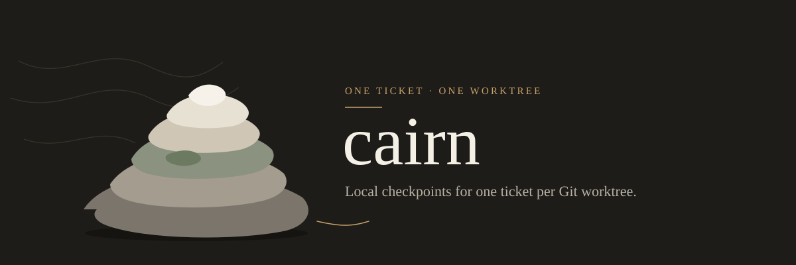
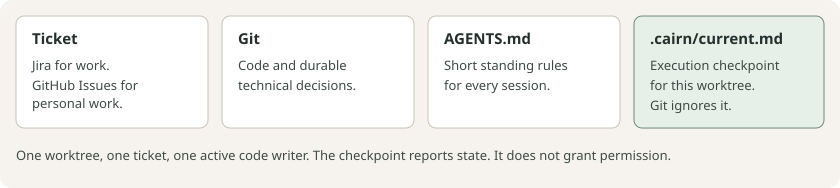
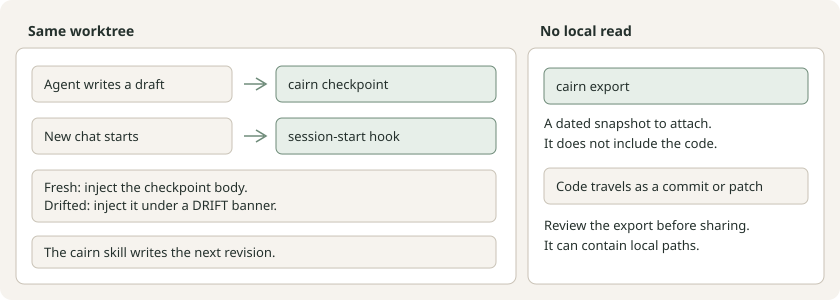

<p align="center">
  
</p>

# cairn

Compact, local checkpoints for one ticket per Git worktree. Switch coding agents
without loading the previous conversation. MIT licensed; no service, account,
subscription, model API, or third-party runtime dependency required.

**Initial prototype.** CLI behavior is tested in disposable Git repositories.
Cross-vendor integrations and token savings have not yet been validated.

## Where state lives



The ticket holds the requirements. Git holds the code. `AGENTS.md` holds short
standing rules. `.cairn/current.md` holds the execution checkpoint for that one
worktree, and Git ignores it. A checkpoint is a report of state, not permission
to deploy, publish, or reopen deferred work.

## Switching agents



In Claude Code, Codex, and Cursor, a new session in the ticket worktree receives
the current checkpoint automatically. When the code has changed since the
checkpoint was written, it arrives under a `DRIFT` banner that tells the agent
to reconcile the diff before trusting recorded verification. Say "checkpoint"
to write the next revision. Grok Build cannot load it at session start, so say
"resume" there. A desktop chat without a shell still uses `cairn export`, and
the code changes travel separately as a commit or patch.

## Agent example

Ask the agent to checkpoint before you switch. The skill runs these commands in
the ticket worktree, so it leaves off `--cwd`.

`cairn status` prints the receipt:

```sh
cairn status
```

Here the worktree is on revision 1 and the code still matches that checkpoint:

```json
{
  "ticket": "https://github.com/OWNER/REPO/issues/142",
  "revision": 1,
  "updated": "2026-10-29T21:04:00.000Z",
  "drift": []
}
```

Use revision 0 only when `status` reports that no checkpoint exists. The agent
prints the template, then fills a draft:

```sh
cairn template
```

```md
# Ticket checkpoint

## Objective and acceptance
Finish issue 142. Accepted when `npm test` passes.

## Current state
The handler is updated. The new test is unfinished.

## Essential decisions
Leave the deferred follow-up closed.

## Verification
`npm test` passed before that unfinished test was added. The new case is unverified.

## Next action
Add that test and run `npm test`.

## Read next
- `src/handler.ts`
- https://github.com/OWNER/REPO/issues/142
```

It pipes the draft in and passes the revision from `status`:

```sh
cairn checkpoint --expected-revision 1 <<'EOF'
# Ticket checkpoint
...
EOF
```

That writes revision 2 and prints
`Checkpoint 2 for https://github.com/OWNER/REPO/issues/142:` plus the absolute
path of `.cairn/current.md`. The ticket comes from the existing checkpoint. The
first checkpoint infers it from the branch: a Jira key such as `PAY-142`, or a
GitHub issue number such as `142-fix-retries` with a `github.com` `origin`.
Otherwise the agent asks once and passes `--ticket`. A conflict means read the
checkpoint now on disk and reconcile the draft.

The next chat in this worktree receives that body from the session-start hook.
To print it again:

```sh
cairn resume
```

`resume` writes the body to stdout and a one-line receipt to stderr. When
`drift` lists any field, it withholds the body. `cairn resume --allow-stale`
prints the body so the agent can reconcile the diff before trusting recorded
verification.

## Requirements

Node.js 20+, Git, and Linux or macOS. Without Node, the hooks inject a one-line
notice and the session continues.

## Install

Claude Code, from a clone of this repository:

```text
/plugin marketplace add /path/to/cairn-checkpoints
/plugin install cairn@cairn-checkpoints
```

The plugin adds the session-start and stop hooks, the `/cairn:checkpoint` skill,
and `cairn` on the agent's `PATH`. No npm step is needed.

Codex, Cursor, and Grok Build, from the same clone:

```sh
skills/checkpoint/scripts/cairn install
```

That copies the skill to `~/.agents/skills/cairn` and adds hooks to
`~/.codex/hooks.json` and `~/.cursor/hooks.json` for the hosts whose directory
exists. Codex runs new hooks only after you trust them, so start `codex` once
and approve the two cairn hooks. It also removes hooks and skill copies left by
earlier versions,
including those in `~/.claude`. `cairn uninstall` removes only cairn's entries.

## Manual commands

Keep this repository separate from the ticket worktree. A host without the
skill can drive the CLI directly. Write the draft from
[the template](skills/checkpoint/template.md) or `cairn template`. The draft is
the outgoing agent's concise account of the task, decisions, verification, and
next action.

```sh
cairn --cwd /path/to/ticket-worktree checkpoint \
  --ticket https://github.com/OWNER/REPO/issues/142 \
  --file /tmp/checkpoint-draft.md --expected-revision 0

cairn --cwd /path/to/ticket-worktree resume
```

A ticket is an issue URL or a bare Jira key. It is an identifier; this tool does
not fetch or post to either service. After the first checkpoint, use `status`
to read the revision and supply it as `--expected-revision` when replacing it.
`--file` resolves relative to the shell invocation directory, not `--cwd`;
without it, the draft is read from standard input.

```sh
cairn --cwd /path/to/ticket-worktree status
cairn --cwd /path/to/ticket-worktree resume --allow-stale
cairn --cwd /path/to/ticket-worktree export > /tmp/ticket-handoff.md
```

`resume` refuses stale code state by default. `--allow-stale` lets an agent read
the checkpoint to reconcile it; it does not certify old test results. Exports
are snapshots for attachment or transfer, and do not contain the actual code
changes. They may include local paths and user-written confidential information;
the prototype does not redact secrets automatically.

The checkpoint lives in `.cairn/current.md` within that worktree and is locally
ignored by Git. Large logs can live in `.cairn/evidence/` and be read on demand.
Keep one active code writer per worktree and checkpoint meaningful changes before
switching. A desktop chat without a shell needs an attached export. The manual
commands above remain the interface for that host. Neither the plugin nor
`cairn install` posts to Jira or GitHub or starts an MCP server.

## Development

```sh
npm install
npm run build
npm test
git diff --check
```

The compiled CLI under `skills/checkpoint/scripts/lib` is committed so the skill
folder works without a build ([ADR 0002](docs/adr/0002-ship-the-cli-inside-the-skill-folder.md)).
Run `npm run build` after changing `src` and commit the result; `npm test` fails
when they differ.

Read [the design](DESIGN.md), [glossary](GLOSSARY.md),
[agent protocol](docs/agent-protocol.md), and [research notes](docs/research.md). No remote repository has been created as part
of the initial local setup.
